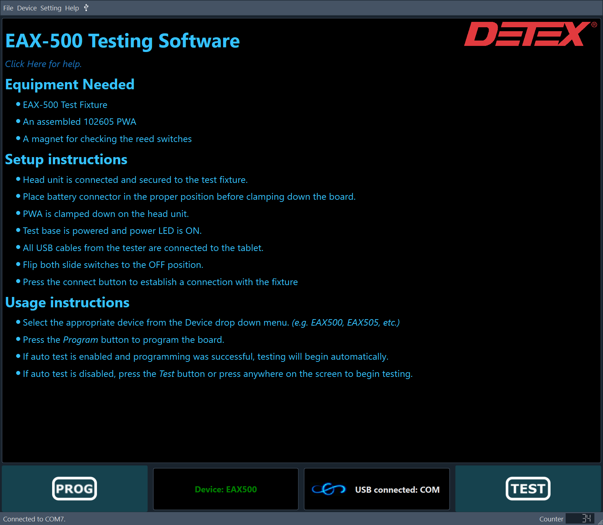
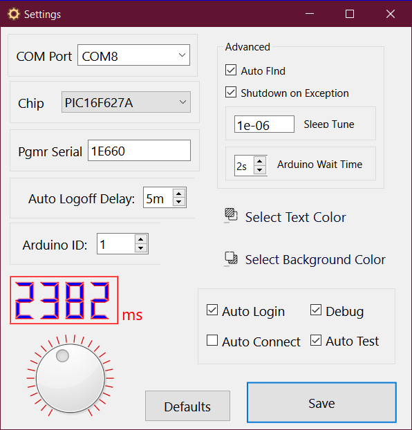

# EAX Test Fixture Interface

This is a Python version of the EAX Test Fixture Interface. It is a GUI built on the Qt framework that allows the user to control the EAX Test Fixture. It is designed to be used with the telemetrix Arduino library. See the [firmware](#firmware) section for more information.

## Installation

1. Install Python 3.7 or later.
2. The programming software called `up.exe` provided for by the [Asix corporation](https://www.asix.net/) is require for programming.
3. Install the required Python package dependencies listed in `requirements.txt` using the command `pip install -r requirements.txt`.
4. A standalone executable can be created using `pyinstaller`. Install `pyinstaller` using the command `pip install pyinstaller`. (Optional)

## Firmware

This application uses the telemetrix Arduino library to communicate with the fixture. It can be compilled and uploaded via the Arduino IDE. This installation of the firmware can be automated using the [Install.ps1](https://github.com/dhahaj/EAX-Python-Interface/blob/main/Install.ps1) script. This script will download the `arduino-cli` tool, install the required libraries, compile the firmware, and upload it to the Arduino. It prompts for the COM port of the Arduino before uploading the firmware. Modify the file [Telemetrix4Arduino.ino](https://github.com/dhahaj/EAX-Python-Interface/blob/main/sketches/Telemetrix4Arduino/Telemetrix4Arduino.ino) to make modifications to the firmware, such as changing the `arduino_instance_id`. See [The Telemetrix Project](https://mryslab.github.io/telemetrix/) for more information.

## Screenshots





## Usage

The EAX Fixture Interface can be modified by changing the values located in the [pins.json](https://github.com/dhahaj/EAX-Python-Interface/blob/main/pins.json), [settings.json](https://github.com/dhahaj/EAX-Python-Interface/blob/main/settings.json), and [users.db](https://github.com/dhahaj/EAX-Python-Interface/blob/main/users.db) files.

### `pins.json`

The [pins.json](https://github.com/dhahaj/EAX-Python-Interface/blob/main/pins.json) file contains the pin assignments for the application. The pin assignments are stored in a JSON object with the following format:

```json
{
    "pins": [
        {
            "pin_number": 2,
            "io_mode": "input",
            "function": "battery",
            "pullup_enabled": false,
        },
    ]
}
```

### `settings.json`

The [settings.json](https://github.com/dhahaj/EAX-Python-Interface/blob/main/settings.json) file contains the runtime settings for the application. The settings are pretty self-explanatory. The `arduino_instance_id` is a value that is set in the firmware and is used where they may be multiple connected devices.

```json
{
    "serial_port": "COM8",
    "programmer_serial_number": "1E660",
    "chip_part": "PIC16F628A",
    "last_user": "dmh",
    "testing_speed": 0.5,
    "auto_test": true,
    "font_family": "Arial",
    "font_size": 14,
    "font_weight": "normal",
    "font_color": "#000000",
    "skip_login": true,
    "auto_connect": false,
    "arduino_instance_id": 1,
    "debug": true,
    "firmware_folder": "",
    "firmware_location": "./firmware"
}

```

### `users.db`

The `users.db` file is a SQLite database is used to store user data. This database uses the following schema:

```sql
CREATE TABLE users (
                        id INTEGER PRIMARY KEY,
                        username TEXT NOT NULL UNIQUE,
                        password TEXT NOT NULL,
                        is_admin BOOLEAN NOT NULL
                    )
```
