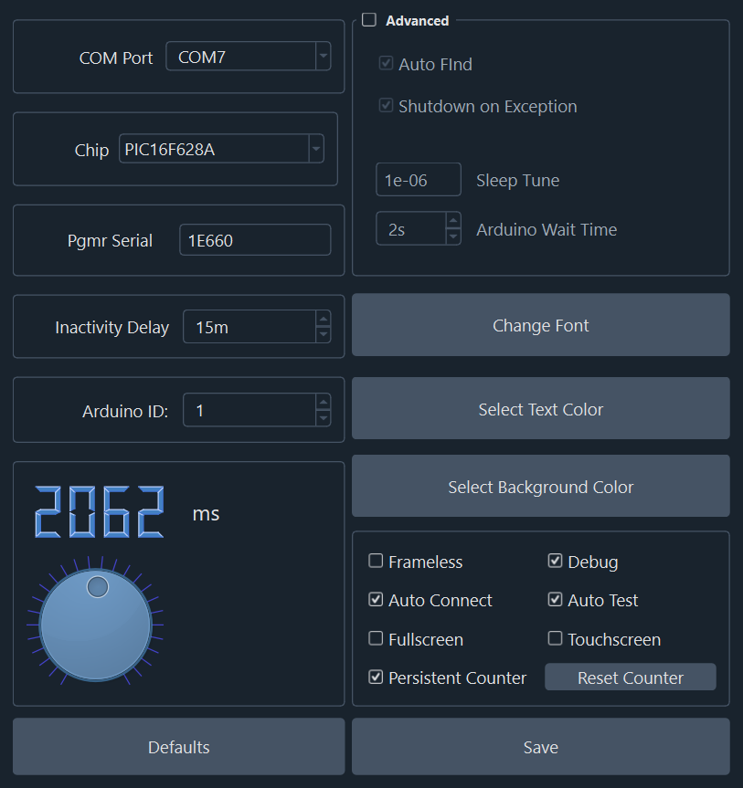
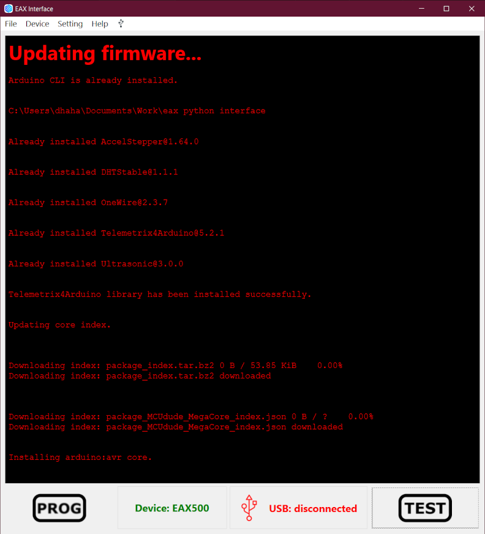

# Usage

## Table of Contents

- [Usage](#usage)
  - [Table of Contents](#table-of-contents)
  - [Installation](#installation)
    - [New Features](#new-features)
    - [GUI](#gui)
    - [Settings](#settings)
    - [Firmware](#firmware)

## Installation

1. Install the firmware to the test fixture. See the [Firmware](#firmware) section for more information.
2. The programming software called `up.exe` provided for by [Asix](https://www.asix.net/) is required for programming.
3. Install Python 3.7 or later from [Python.org](https://www.python.org/).
4. Run `Start.bat` from the `Scrpts` directory to start the application.
5. Install the required Python package dependencies listed in `requirements.txt` using the command `pip install -r requirements.txt`.
6. A standalone executable can be created using `pyinstaller`. Install `pyinstaller` using the command `pip install pyinstaller`. (Optional)

The EAX Test Interface is an improvement over the last version. The interface was written in pure Python using the [Pyside6](https://doc.qt.io/qtforpython-6/) library and [Qt](https://www.qt.io/) framwork. The improvements are listed below:

- Using an improved firmware for communicating with the fixture. It includes improvements to both the communication speed and allows for multiple devices to be connected to the same computer.
- The `Install.PS1` script can be used to automatically download and install the latest firmware. Requires an internet connection. See the [Firmware](#firmware) section for more information.
- The settings are now stored in a plaint text file called `settings.json`. This file contains a JSON object that represents all the runtime settings. There should not be any need to modify this file as all the settings can be changed in the application.
- The pin assignments are now stored in a plain text file called `pins.json`. This file contains a JSON object that represents all the pin assignments. There should not be any need to modify this file as all the pin assignments can be changed in the application.
The EAX Test Interface is an improvement over the last version. The interface was written in pure Python using the [Pyside6](https://doc.qt.io/qtforpython-6/) and Qt framwork. The improvements are listed below:

### New Features

1. Changing the serial numbers for the programmer can be done directly now in the settings menu. See the [Settings](#settings) section for more information.
2. The login process can be skipped by enabling the `Auto Login` setting. Note to avoid the possibility of a user accidentally modifying the settings, a person will still be required to login as an administrator to change the settings.
3. The application can automatically find the correct USB port by enabling the `Auto Find` setting. It will scan and test all USB ports and automatically connect to the correct one. The `Auto Connect` setting will automatically connect to the fixture when the application is started.
4. If for some reason two fixtures are to be connected to the same computer, the `arduino_instance_id` setting can be changed so that the application will only connect to the fixture with the matching `arduino_instance_id`. Note that to do this, the firmware will need to be recompilled and uploaded to the test fixture.

<!-- pagebreak -->

### GUI

The main window is composed of a text console, two buttons and two labels. The text console is used for displaying messages, and the buttons are used for programming and testing. The two text labels are used for displaying the status of the USB connection and the currently selected device. The menu bar contains the `File`, `Device`, `Settings` and `Help` menus. The `File` menu contains items for logging in and out, connecting and disconnecting from the fixture, and exiting the application. The `Device` menu contains items for selecting the device. The `Settings` menu contains various items for modifying the settings. The `Help` menu contains items for displaying the debugging logs and displaying the about dialog.

### Settings

The settings can be changed by clicking on the `Modify Settings` menu item. This will open up a new window as shown below. Any changes made on this window will not be applied until the `Save` button is pressed. The `Default` button will reset all the settings to their default values. The dial on the bottom right can be used to change the testing speed. Rotating it CW will increase the speed and CCW will decrease the speed. The exact timing is shown just above the dial, which is specified in ms. The `Debug` checkbox just enables additional debug messages to be printed to the console and to the log file. The `Auto Logoff Delay` is the amount of time in minutes before the application will automatically logoff the current user (note that this is only valid if `Auto Login` is disabled). The `Chip` combobox is used to select the particular chip that is populated on the EAX board. This setting can be changed here or by selecting `Chip Select` from the settings menu. All the items in the `Advanced` section should not be changed unless you know what you are doing. These settings modify how the application interacts with the fixture and the firmware.

<!--  -->

### Firmware

The test fixture uses an arduino library called `Telemetrix`. It can easily be installed to the test fixture using the `Arduino` IDE, or with the `Install.ps1` or `UpdateFirmware.ps1` scripts located in the `Scripts` folder. To run the script from the GUI, select `Update Firmware` from the `Settings` menu. This will attempt to download and update the `arduino_cli` tool, compile the firmware, and upload it to the test fixture. The basic steps for updating the firmware are listed below:

1. An internet connection may be required if the necessary files have not already been downloaded.
2. Ensure that the test fixture is connected to the computer but is not connected to the application.
3. Open the `Settings` menu and make sure that `COM Port` and `arduino_instance_id` are set to the correct values. These will be the values used to upload the firmware. Press `Save` to save the settings.
4. From the `Settings` menu, select `Update Firmware`. This will start the firmware update process and its progress will be displayed in the console window. (See the image below)

